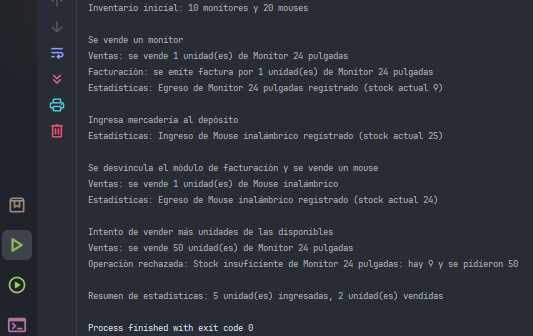

# Ejercicio 08 - Refactorización de Código Acoplado hacia Bus de Eventos

## Descripción

Una aplicación heredada de gestión de inventarios llama de forma directa y rígida desde la clase de productos al módulo de facturación y al de estadísticas. Cualquier cambio en esos módulos rompe el código principal. Se refactoriza hacia una estructura basada en eventos con el patrón Observer.

## Objetivos

- Eliminar las referencias directas a servicios concretos dentro de la lógica del inventario.
- Convertir el inventario en sujeto observable y los módulos en observadores independientes.
- Aplicar abstracción e inversión de control.
- Dejar al inventario con la única responsabilidad de gestionar su stock y notificar.

## Implementación del patrón Observer

**Antes (acoplado):** el producto crea y llama directamente a los módulos.

```java
public class Product {
    private final BillingModule billingModule = new BillingModule();
    private final StatisticsModule statisticsModule = new StatisticsModule();

    public void removeStock(int quantity) {
        this.stock -= quantity;
        billingModule.issueInvoice(name, quantity);
        statisticsModule.register(name, quantity);
    }
}
```

**Después (Observer):**

- **Sujeto:** `Inventory` gestiona el stock y una lista de `StockListener`. Cada movimiento genera un `StockEvent` y se notifica.
- **Observador:** `StockListener` declara `onStockChanged(StockEvent event)`.
- **Observadores concretos:** `BillingModule` (factura los egresos) y `StatisticsModule` (acumula ingresos y ventas).
- **Inversión de control:** `Inventory` recibe los oyentes por constructor. `SalesService` solo conoce el inventario, no los módulos.
- **Composición:** únicamente `Main` conoce los módulos concretos.

## Propósito de la clase

- `StockChangeType`: tipo de movimiento (ingreso o egreso).
- `StockEvent`: evento inmutable con los datos del movimiento.
- `StockListener`: abstracción que reemplaza las dependencias directas.
- `Inventory`: sujeto observable que gestiona su propio stock.
- `SalesService`: clase de negocio que registra ventas.
- `BillingModule`: módulo de facturación.
- `StatisticsModule`: módulo de estadísticas.
- `Main`: arma la composición, mueve stock, desvincula un módulo y rechaza una venta inválida.

## Concepto clave

Se invierte la dependencia: el inventario ya no depende de los módulos concretos, sino de una interfaz. Agregar, quitar o cambiar un módulo no obliga a modificar el inventario.

## Resultado



## Conclusión

La refactorización reduce el acoplamiento y respeta el principio abierto/cerrado. El inventario se limita a gestionar su stock y los módulos pueden evolucionar o reemplazarse sin romper el código principal.
